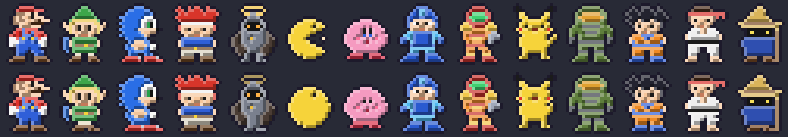

# pixel-sidebar

Uma barra lateral para o [Claude Code](https://claude.com/claude-code) que mostra o que importa na sessão (modelo, contexto, custo, agentes e tarefas) e, embaixo, um palco em pixel art com personagens estilo SNES que conversam com você enquanto trabalha.



## O que tem

- **Painel**: modelo atual, barra de uso do contexto, custo da sessão, agentes ativos e a checklist de tarefas (TodoWrite).
- **Palco**: um cenário discreto em tons de cinza do tema. O céu muda com a hora do dia, o sol e a lua fazem seu arco e aparecem nuvens, chuva, uma árvore, grama e um passarinho de vez em quando. Só os personagens e os especiais são coloridos.
- **14 personagens** que se revezam a cada ~90 s: Mario, Link, Sonic, Crono, Tarnished, Pac-Man, Kirby, Mega Man, Samus, Pikachu, Master Chief, Goku, Ryu e Black Mage.
- **Falas em balão de RPG**, com o texto surgindo letra a letra. São piadas, frases de motivação, comentários sobre o que está sendo feito (arquivo editado, tarefas, custo), hora do dia, dia da semana, datas especiais e o clima.
- **Especiais que quebram a quarta parede**: o golpe sai da barra lateral e atravessa a tela inteira numa faixa acima do prompt.
- **Reações**: quando uma tarefa é concluída, quando o Claude pede autorização ou quando o turno termina, o personagem comenta e solta o especial.

## Instalação

No Claude Code, digite:

```
/plugin install pixel-sidebar --marketplace karnagge/pixel-sidebar
```

Responda `y` para adicionar o marketplace e escolha o escopo (usuário é o padrão).

### Requisito: modo tela cheia

O painel só fica encaixado ao lado da conversa no layout de tela cheia, com o terminal tendo 110 colunas ou mais. Para ativar, adicione ao seu `~/.claude/settings.json`:

```json
{
  "env": { "CLAUDE_CODE_NO_FLICKER": "1" }
}
```

Fora da tela cheia, o painel abre inline.

## Comandos

| Comando | O que faz |
|---|---|
| `/sidebar` | Abre a barra lateral, caso ela tenha sido fechada |
| `/especial` | O personagem atual solta o especial agora |
| `/especial goku` | Chama um personagem específico (o nome pode ser parcial) |

## Observações

- O clima vem de [wttr.in](https://wttr.in), pela localização do seu IP, no máximo uma vez por hora. Sem internet, o palco funciona normalmente, só que sem as falas sobre o clima.
- As falas estão em português brasileiro.
- Para desenvolver, rode `claude --plugin-dir .` a partir da pasta do repositório. Os testes rodam com `claude plugin test .`.

## Aviso sobre fan art

Este é um projeto de fã, sem fins comerciais. Os personagens são releituras em pixel art feitas à mão e pertencem aos seus respectivos donos (Nintendo, SEGA, Square Enix, FromSoftware, Bandai Namco, Capcom, Microsoft, The Pokémon Company, Toei/Shueisha e outros). O projeto não tem afiliação com nenhuma dessas empresas nem é endossado por elas. Se você é titular de algum desses direitos e quer que algo seja removido, abra uma issue e o conteúdo será retirado.

## Licença

O código está sob licença [MIT](LICENSE). A licença não se aplica aos personagens nem às marcas citadas acima.
